## Descripció

Treballarem amb una base de dades que conté col·leccions relacionades amb una aplicació d'entreteniment cinematogràfic:

- `users`: Emmagatzema informació d'usuaris/es, incloent-hi noms, emails i contrasenyes xifrades.
- `theatres`: Conté dades de cinemes, com ID, ubicació (direcció i coordenades geogràfiques).
- `sessions`: Guarda sessions d'usuari, incloent-hi ID d'usuari i tokens JWT per a l'autenticació.
- `movies`: Inclou detalls de pel·lícules, com a trama, gèneres, durada, elenc, comentaris, any de llançament, directors, classificació i premis.
- `comments`: Emmagatzema comentaris d'usuaris/es sobre pel·lícules, amb informació de l'autor/a del comentari, ID de la pel·lícula, text del comentari i la data.

Duràs a terme algunes consultes que et demana el client/a, el qual està mesurant si seràs capaç o no de fer-te càrrec de la part analítica del projecte vinculat amb la seva base de dades.
## Nivell 1

Crea una base de dades amb MongoDB utilitzant com a col·leccions els arxius adjunts.

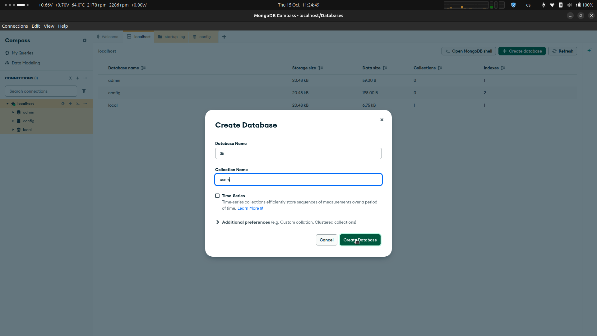

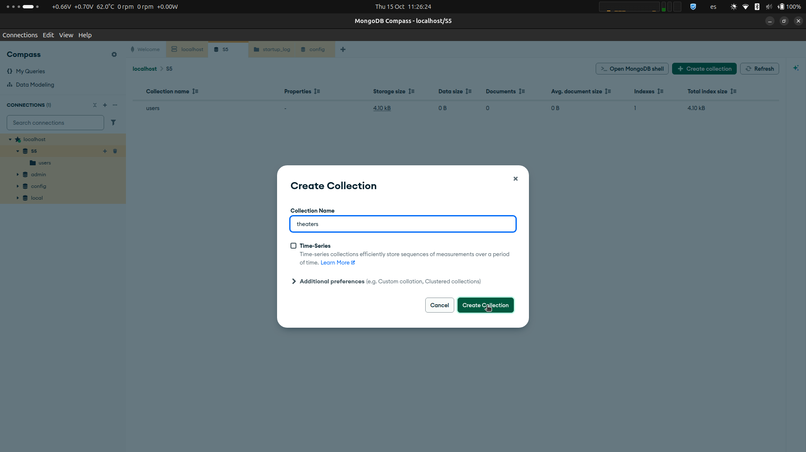

» Repeat to create all remaining collections...

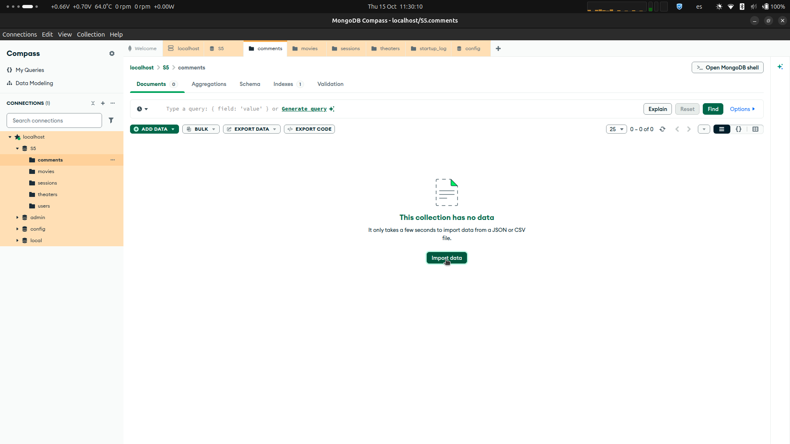

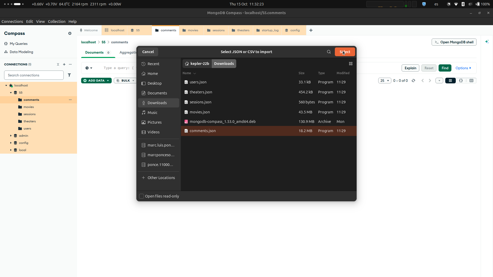


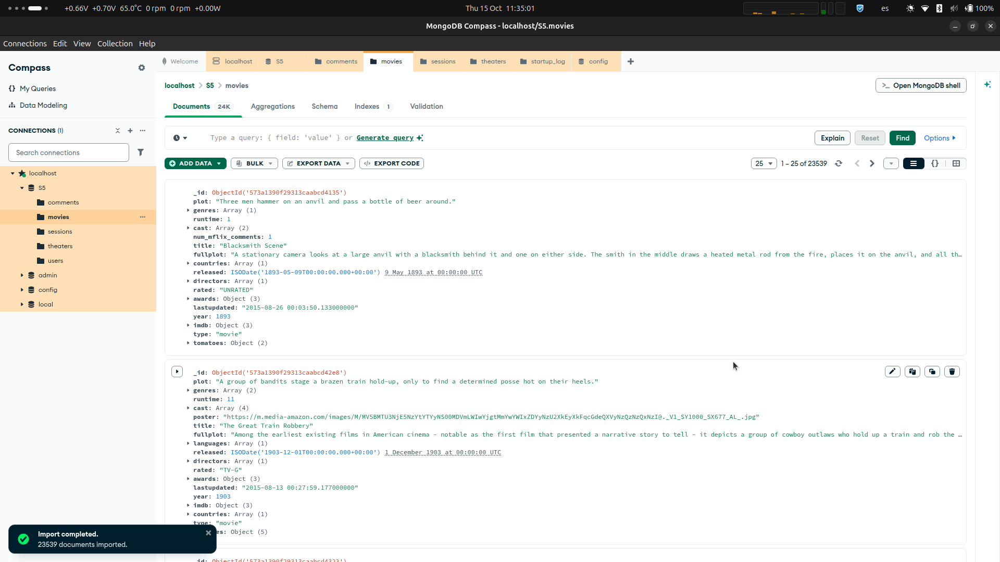

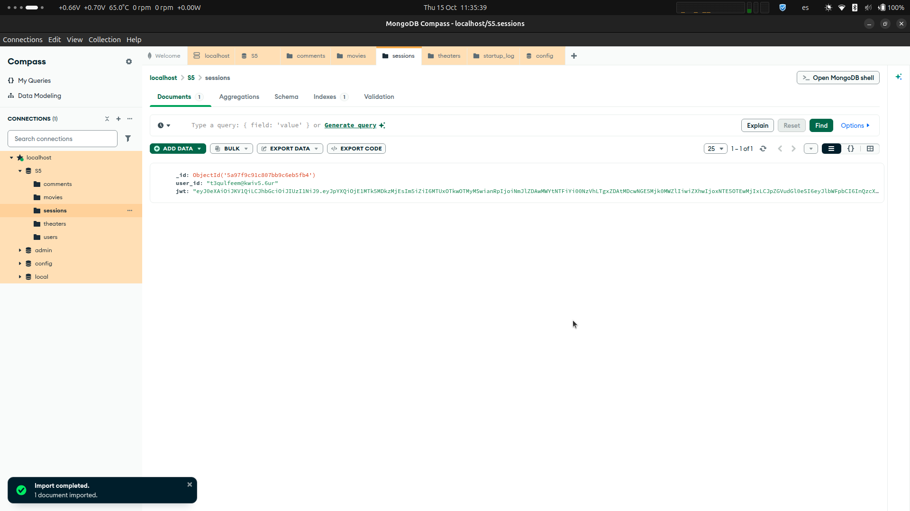


### Exercici 1

1. Mostra els 2 primers comentaris que hi ha en la base de dades.

```JSON
db["comments"].find().sort({"date":1}).limit(2)
```

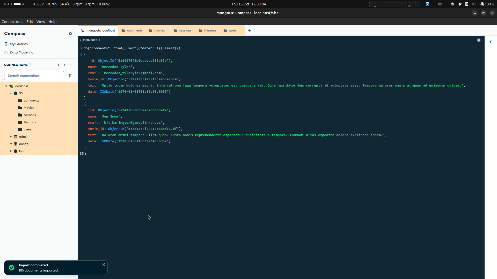

2. Quants usuaris tenim registrats?

```JSON
db["users"].find().count()
```

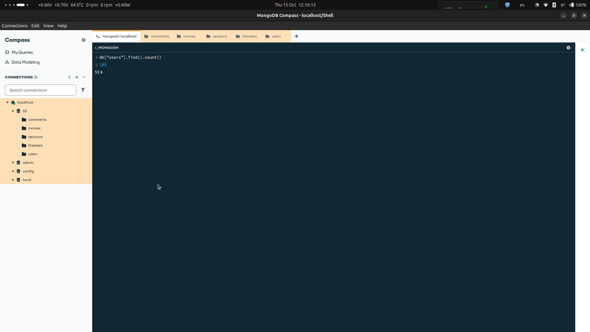

» Answer: `185`

3. Quants cinemes hi ha en l'estat de Califòrnia?

```JSON
db.theaters.aggregate([
  {$group: {
    _id: {
      state: "$location.address.state"
    }
  }},
  {$project: {
    _id: 0, 
    state: "$_id.state" 
  }},
  {$sort: {
      state: 1
  }}
]).toArray()
```

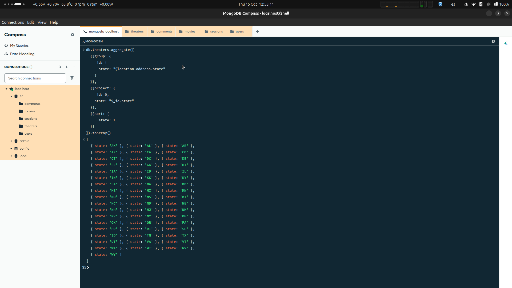

» The output shows us that the states are denominated by their initials, since there's only one `CA`, I can assume that is California. With an internet search I have determined that these codes are **USPS two-letter postal abbreviations**, and that `CA` is indeed California.

```JSON
[
  { state: 'AK' }, { state: 'AL' }, { state: 'AR' },
  { state: 'AZ' }, { state: 'CA' }, { state: 'CO' },
  { state: 'CT' }, { state: 'DC' }, { state: 'DE' },
  { state: 'FL' }, { state: 'GA' }, { state: 'HI' },
  { state: 'IA' }, { state: 'ID' }, { state: 'IL' },
  { state: 'IN' }, { state: 'KS' }, { state: 'KY' },
  { state: 'LA' }, { state: 'MA' }, { state: 'MD' },
  { state: 'ME' }, { state: 'MI' }, { state: 'MN' },
  { state: 'MO' }, { state: 'MS' }, { state: 'MT' },
  { state: 'NC' }, { state: 'ND' }, { state: 'NE' },
  { state: 'NH' }, { state: 'NJ' }, { state: 'NM' },
  { state: 'NV' }, { state: 'NY' }, { state: 'OH' },
  { state: 'OK' }, { state: 'OR' }, { state: 'PA' },
  { state: 'PR' }, { state: 'RI' }, { state: 'SC' },
  { state: 'SD' }, { state: 'TN' }, { state: 'TX' },
  { state: 'UT' }, { state: 'VA' }, { state: 'VT' },
  { state: 'WA' }, { state: 'WI' }, { state: 'WV' },
  { state: 'WY' }
]
```

» We can proceed querying all theaters in California.

```JSON
db.theaters.find({"location.address.state":"CA"}).count()
```


» Answer: `169`

4. Quin va ser el primer usuari/ària en registrar-se?

» `_id` is an autogenerated `ObjectId`, and the first four bytes are a Unix timestamp. Sorting by `_id` ascending should yield the first user to register.

```JSON
db.users.find().sort({_id:1}).limit(1)
```


5. Quantes pel·lícules de comèdia hi ha en la nostra base de dades?

```JSON
db.movies.aggregate([
  { $unwind: "$genres" },
  { $group: { _id: "$genres" } },
  { $project: { _id: 0, genre: "$_id" } },
  { $sort: { genre: 1 } }
]).toArray()
```


```JSON
[
  { genre: 'Action' },      { genre: 'Adventure' },
  { genre: 'Animation' },   { genre: 'Biography' },
  { genre: 'Comedy' },      { genre: 'Crime' },
  { genre: 'Documentary' }, { genre: 'Drama' },
  { genre: 'Family' },      { genre: 'Fantasy' },
  { genre: 'Film-Noir' },   { genre: 'History' },
  { genre: 'Horror' },      { genre: 'Music' },
  { genre: 'Musical' },     { genre: 'Mystery' },
  { genre: 'News' },        { genre: 'Romance' },
  { genre: 'Sci-Fi' },      { genre: 'Short' },
  { genre: 'Sport' },       { genre: 'Talk-Show' },
  { genre: 'Thriller' },    { genre: 'War' },
  { genre: 'Western' }
]
```

```JSON
db.movies.find({genres:"Comedy"}).count()
```


» Answer: `7024`

### Exercici 2

Mostra'm tots els documents de les pel·lícules produïdes en 1932, però que el gènere sigui drama o estiguin en francès.

```JSON
db.movies.aggregate([
  { $unwind: "$languages" },
  { $group: { _id: "$languages" } },
  { $project: { _id: 0, language: "$_id" } },
  { $sort: { language: 1 } }
]).toArray()
```

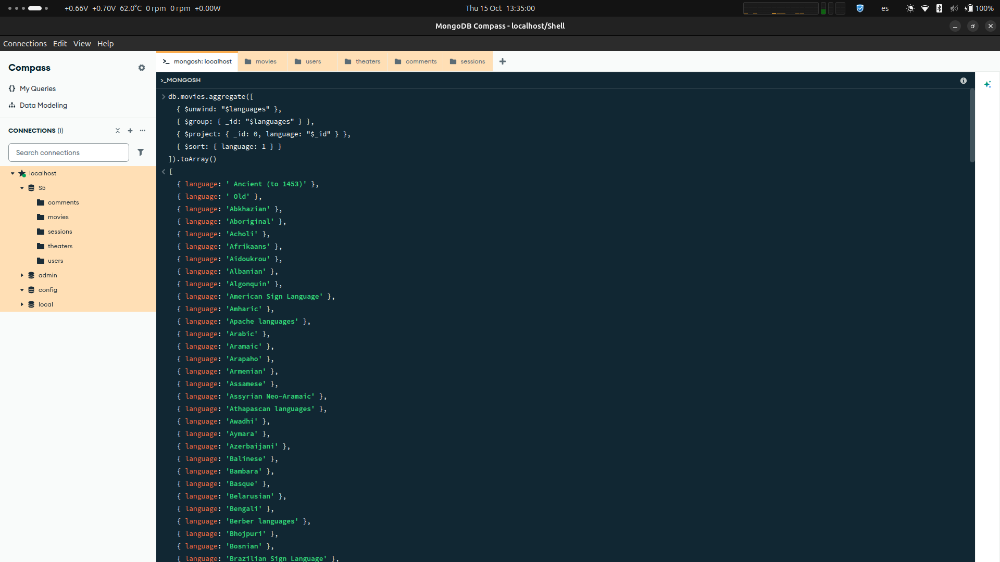

```JSON
[
  { language: ' Ancient (to 1453)' },
  { language: ' Old' },
  { language: 'Abkhazian' },
  { language: 'Aboriginal' },
  { language: 'Acholi' },
  { language: 'Afrikaans' },
  { language: 'Aidoukrou' },
  { language: 'Albanian' },
  { language: 'Algonquin' },
  { language: 'American Sign Language' },
  { language: 'Amharic' },
  { language: 'Apache languages' },
  { language: 'Arabic' },
  { language: 'Aramaic' },
  { language: 'Arapaho' },
  { language: 'Armenian' },
  { language: 'Assamese' },
  { language: 'Assyrian Neo-Aramaic' },
  { language: 'Athapascan languages' },
  { language: 'Awadhi' },
  { language: 'Aymara' },
  { language: 'Azerbaijani' },
  { language: 'Balinese' },
  { language: 'Bambara' },
  { language: 'Basque' },
  { language: 'Belarusian' },
  { language: 'Bengali' },
  { language: 'Berber languages' },
  { language: 'Bhojpuri' },
  { language: 'Bosnian' },
  { language: 'Brazilian Sign Language' },
  { language: 'Breton' },
  { language: 'British Sign Language' },
  { language: 'Bulgarian' },
  { language: 'Burmese' },
  { language: 'Cantonese' },
  { language: 'Catalan' },
  { language: 'Chechen' },
  { language: 'Cheyenne' },
  { language: 'Chinese' },
  { language: 'Cornish' },
  { language: 'Corsican' },
  { language: 'Cree' },
  { language: 'Creole' },
  { language: 'Creoles and pidgins' },
  { language: 'Croatian' },
  { language: 'Crow' },
  { language: 'Czech' },
  { language: 'Danish' },
  { language: 'Dari' },
  { language: 'Dinka' },
  { language: 'Dutch' },
  { language: 'Dyula' },
  { language: 'Dzongkha' },
  { language: 'Eastern Frisian' },
  { language: 'Egyptian (Ancient)' },
  { language: 'English' },
  { language: 'Esperanto' },
  { language: 'Estonian' },
  { language: 'Ewe' },
  { language: 'Faroese' },
  { language: 'Filipino' },
  { language: 'Finnish' },
  { language: 'Flemish' },
  { language: 'French' },
  { language: 'French Sign Language' },
  { language: 'Frisian' },
  { language: 'Fulah' },
  { language: 'Fur' },
  { language: 'Gallegan' },
  { language: 'Georgian' },
  { language: 'German' },
  { language: 'German Sign Language' },
  { language: 'Greek' },
  { language: 'Greenlandic' },
  { language: 'Guarani' },
  { language: 'Gujarati' },
  { language: 'Gumatj' },
  { language: 'Haitian' },
  { language: 'Hakka' },
  { language: 'Haryanvi' },
  { language: 'Hassanya' },
  { language: 'Hawaiian' },
  { language: 'Hebrew' },
  { language: 'Hindi' },
  { language: 'Hmong' },
  { language: 'Hokkien' },
  { language: 'Hungarian' },
  { language: 'Ibo' },
  { language: 'Icelandic' },
  { language: 'Indian Sign Language' },
  { language: 'Indonesian' },
  { language: 'Inuktitut' },
  { language: 'Inupiaq' },
  { language: 'Irish' },
  { language: 'Italian' },
  { language: 'Japanese' },
  { language: 'Japanese Sign Language' },
  { language: 'Jola-Fonyi' },
  { language: 'Kabuverdianu' },
  { language: 'Kabyle' },
  { language: 'Kannada' },
  { language: 'Karajè' },
  { language: 'Kazakh' },
  { language: 'Khmer' },
  { language: 'Kikuyu' },
  { language: 'Kinyarwanda' },
  { language: 'Kirghiz' },
  { language: 'Klingon' },
  { language: 'Konkani' },
  { language: 'Korean' },
  { language: 'Korean Sign Language' },
  { language: 'Kuna' },
  { language: 'Kurdish' },
  { language: 'Ladakhi' },
  { language: 'Ladino' },
  { language: 'Lao' },
  { language: 'Latin' },
  { language: 'Latvian' },
  { language: 'Lingala' },
  { language: 'Lithuanian' },
  { language: 'Low German' },
  { language: 'Luxembourgish' },
  { language: 'Macedonian' },
  { language: 'Malay' },
  { language: 'Malayalam' },
  { language: 'Malinka' },
  { language: 'Maltese' },
  { language: 'Mandarin' },
  { language: 'Manipuri' },
  { language: 'Maori' },
  { language: 'Mapudungun' },
  { language: 'Marathi' },
  { language: 'Mari' },
  { language: 'Masai' },
  { language: 'Maya' },
  { language: 'Mende' },
  { language: 'Middle English' },
  { language: 'Min Nan' },
  { language: 'Mohawk' },
  { language: 'Mongolian' },
  { language: 'More' },
  { language: 'Nahuatl' },
  { language: 'Nama' },
  { language: 'Navajo' },
  { language: 'Neapolitan' },
  { language: 'Nenets' },
  { language: 'Nepali' },
  { language: 'Norse' },
  { language: 'North American Indian' },
  { language: 'Norwegian' },
  { language: 'Nyaneka' },
  { language: 'Nyanja' },
  { language: 'Occitan' },
  { language: 'Old English' },
  { language: 'Oriya' },
  { language: 'Panjabi' },
  { language: 'Pawnee' },
  { language: 'Persian' },
  { language: 'Peul' },
  { language: 'Polish' },
  { language: 'Polynesian' },
  { language: 'Portuguese' },
  { language: 'Purepecha' },
  { language: 'Pushto' },
  { language: 'Quechua' },
  { language: 'Quenya' },
  { language: 'Rajasthani' },
  { language: 'Romanian' },
  { language: 'Romany' },
  { language: 'Russian' },
  { language: 'Russian Sign Language' },
  { language: 'Ryukyuan' },
  { language: 'Saami' },
  { language: 'Samoan' },
  { language: 'Sanskrit' },
  { language: 'Sardinian' },
  { language: 'Scanian' },
  { language: 'Scots' },
  { language: 'Scottish Gaelic' },
  { language: 'Serbian' },
  { language: 'Serbo-Croatian' },
  { language: 'Shanghainese' },
  { language: 'Shanxi' },
  { language: 'Shona' },
  { language: 'Shoshoni' },
  { language: 'Sicilian' },
  { language: 'Sign Languages' },
  { language: 'Sindarin' },
  { language: 'Sinhalese' },
  { language: 'Sioux' },
  { language: 'Slovak' },
  { language: 'Slovenian' },
  { language: 'Somali' },
  { language: 'Songhay' },
  { language: 'Southern Sotho' },
  { language: 'Spanish' },
  { language: 'Spanish Sign Language' },
  { language: 'Swahili' },
  { language: 'Swedish' },
  { language: 'Swiss German' },
  { language: 'Syriac' },
  { language: 'Tagalog' },
  { language: 'Tajik' },
  { language: 'Tamil' },
  { language: 'Tarahumara' },
  { language: 'Tatar' },
  { language: 'Telugu' },
  { language: 'Thai' },
  { language: 'Tibetan' },
  { language: 'Tigrigna' },
  { language: 'Tok Pisin' },
  { language: 'Tonga' },
  { language: 'Tswana' },
  { language: 'Tulu' },
  { language: 'Tupi' },
  { language: 'Turkish' },
  { language: 'Turkmen' },
  { language: 'Tuvinian' },
  { language: 'Tzotzil' },
  { language: 'Uighur' },
  { language: 'Ukrainian' },
  { language: 'Ungwatsi' },
  { language: 'Urdu' },
  { language: 'Uzbek' },
  { language: 'Vietnamese' },
  { language: 'Visayan' },
  { language: 'Washoe' },
  { language: 'Welsh' },
  { language: 'Wolof' },
  { language: 'Xhosa' },
  { language: 'Yiddish' },
  { language: 'Yoruba' },
  { language: 'Zulu' }
]
```

```JSON
db.movies.find({
  year: 1932,
  $or: [
    {genres: "Drama"},
    {languages: "French"}
  ]
})
```


### Exercici 3

Mostra'm tots els documents de pel·lícules estatunidenques que tinguin entre 5 i 9 premis que van ser produïdes entre 2012 i 2014.

```JSON
db.movies.aggregate([
  { $unwind: "$countries" },
  { $group: { _id: "$countries" } },
  { $project: { _id: 0, country: "$_id" } },
  { $sort: { country: 1 } }
]).toArray()
```


```JSON
[
  { country: 'Afghanistan' },
  { country: 'Albania' },
  { country: 'Algeria' },
  { country: 'Angola' },
  { country: 'Argentina' },
  { country: 'Armenia' },
  { country: 'Aruba' },
  { country: 'Australia' },
  { country: 'Austria' },
  { country: 'Bahamas' },
  { country: 'Bangladesh' },
  { country: 'Belarus' },
  { country: 'Belgium' },
  { country: 'Bermuda' },
  { country: 'Bhutan' },
  { country: 'Bolivia' },
  { country: 'Bosnia and Herzegovina' },
  { country: 'Botswana' },
  { country: 'Brazil' },
  { country: 'Brunei' },
  { country: 'Bulgaria' },
  { country: 'Burkina Faso' },
  { country: 'Burma' },
  { country: 'Cambodia' },
  { country: 'Cameroon' },
  { country: 'Canada' },
  { country: 'Chad' },
  { country: 'Chile' },
  { country: 'China' },
  { country: 'Colombia' },
  { country: 'Congo' },
  { country: 'Costa Rica' },
  { country: 'Croatia' },
  { country: 'Cuba' },
  { country: 'Cyprus' },
  { country: 'Czech Republic' },
  { country: 'Czechoslovakia' },
  { country: "Cète d'Ivoire" },
  { country: 'Denmark' },
  { country: 'Dominican Republic' },
  { country: 'East Germany' },
  { country: 'Ecuador' },
  { country: 'Egypt' },
  { country: 'El Salvador' },
  { country: 'Estonia' },
  { country: 'Ethiopia' },
  { country: 'Faroe Islands' },
  { country: 'Federal Republic of Yugoslavia' },
  { country: 'Finland' },
  { country: 'France' },
  { country: 'Gabon' },
  { country: 'Georgia' },
  { country: 'Germany' },
  { country: 'Ghana' },
  { country: 'Greece' },
  { country: 'Greenland' },
  { country: 'Guatemala' },
  { country: 'Haiti' },
  { country: 'Hong Kong' },
  { country: 'Hungary' },
  { country: 'Iceland' },
  { country: 'India' },
  { country: 'Indonesia' },
  { country: 'Iran' },
  { country: 'Iraq' },
  { country: 'Ireland' },
  { country: 'Isle Of Man' },
  { country: 'Israel' },
  { country: 'Italy' },
  { country: 'Jamaica' },
  { country: 'Japan' },
  { country: 'Jordan' },
  { country: 'Kazakhstan' },
  { country: 'Kenya' },
  { country: 'Kosovo' },
  { country: 'Kuwait' },
  { country: 'Kyrgyzstan' },
  { country: 'Laos' },
  { country: 'Latvia' },
  { country: 'Lebanon' },
  { country: 'Liberia' },
  { country: 'Liechtenstein' },
  { country: 'Lithuania' },
  { country: 'Luxembourg' },
  { country: 'Macao' },
  { country: 'Madagascar' },
  { country: 'Malaysia' },
  { country: 'Mali' },
  { country: 'Malta' },
  { country: 'Martinique' },
  { country: 'Mauritania' },
  { country: 'Mexico' },
  { country: 'Micronesia' },
  { country: 'Moldova' },
  { country: 'Monaco' },
  { country: 'Mongolia' },
  { country: 'Montenegro' },
  { country: 'Morocco' },
  { country: 'Nepal' },
  { country: 'Netherlands' },
  { country: 'New Zealand' },
  { country: 'Nigeria' },
  { country: 'North Korea' },
  { country: 'Norway' },
  { country: 'Pakistan' },
  { country: 'Palestine' },
  { country: 'Panama' },
  { country: 'Papua New Guinea' },
  { country: 'Paraguay' },
  { country: 'Peru' },
  { country: 'Philippines' },
  { country: 'Poland' },
  { country: 'Portugal' },
  { country: 'Puerto Rico' },
  { country: 'Qatar' },
  { country: 'Republic of Macedonia' },
  { country: 'Romania' },
  { country: 'Russia' },
  { country: 'Rwanda' },
  { country: 'Samoa' },
  { country: 'Saudi Arabia' },
  { country: 'Senegal' },
  { country: 'Serbia' },
  { country: 'Serbia and Montenegro' },
  { country: 'Singapore' },
  { country: 'Slovakia' },
  { country: 'Slovenia' },
  { country: 'Somalia' },
  { country: 'South Africa' },
  { country: 'South Korea' },
  { country: 'Soviet Union' },
  { country: 'Spain' },
  { country: 'Sri Lanka' },
  { country: 'Sweden' },
  { country: 'Switzerland' },
  { country: 'Syria' },
  { country: 'Taiwan' },
  { country: 'Tajikistan' },
  { country: 'Tanzania' },
  { country: 'Thailand' },
  { country: 'The Democratic Republic Of Congo' },
  { country: 'Trinidad and Tobago' },
  { country: 'Tunisia' },
  { country: 'Turkey' },
  { country: 'UK' },
  { country: 'USA' },
  { country: 'Uganda' },
  { country: 'Ukraine' },
  { country: 'United Arab Emirates' },
  { country: 'Uruguay' },
  { country: 'Uzbekistan' },
  { country: 'Vanuatu' },
  { country: 'Venezuela' },
  { country: 'Vietnam' },
  { country: 'West Germany' },
  { country: 'Yugoslavia' },
  { country: 'Zaire' },
  { country: 'Zimbabwe' }
]
```

```JSON
db.movies.find({
  countries: "USA",
  $expr: {
    $and: [
      {$gte: ["$awards.wins", 5]},
      {$lte: ["$awards.wins", 9]},
      {$gte: ["$year", 2012]},
      {$lte: ["$year", 2014]}
    ]
  }
})   
```

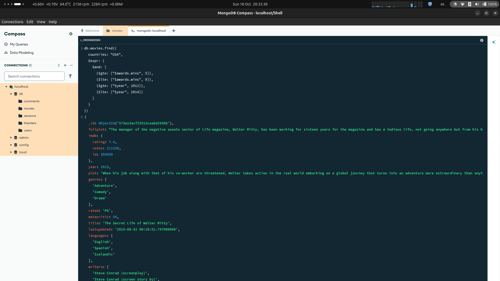

## Nivell 2

### Exercici 1

Compte quants comentaris escriu un usuari/ària que utilitza `GAMEOFTHRON.ES` com a domini de correu electrònic.

```JSON
db.comments.aggregate(
    { $match: {email: { $regex: "@gameofthron\\.es", $options: "i" } } },
    { $group: { _id: "$email", count: { $sum: 1 } } },
    { $project: { _id: 0, email: "$_id", count: 1 } },
    { $sort: { count: -1 } }
)
```


### Exercici 2

Quants cinemes hi ha en cada codi postal situats dins de l'estat Washington D. C. (DC)?

```JSON
db.theaters.aggregate(
    { $match: { "location.address.state": "DC" } },
    { $group: { _id: "$location.address.zipcode", count: { $sum: 1 } } },
    { $project: { _id: 0, zipcode: "$_id", count: 1 } },
    { $sort: { count: -1 } }
)
```


## Nivell 3

### Exercici 1

Troba totes les pel·lícules dirigides per John Landis amb una puntuació `IMDb (Internet Movie Database)` d'entre 7,5 i 8.

```JSON
db.movies.find({
  directors: "John Landis",
  $expr: {
    $and: [
      {$gte: ["$imdb.rating", 7.5]},
      {$lte: ["$imdb.rating", 8]}
    ]
  }
})   
```

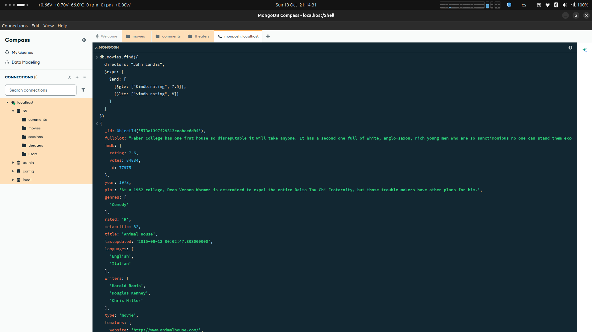

### Exercici 2

Mostra en un mapa la ubicació de tots els teatres de la base de dades.

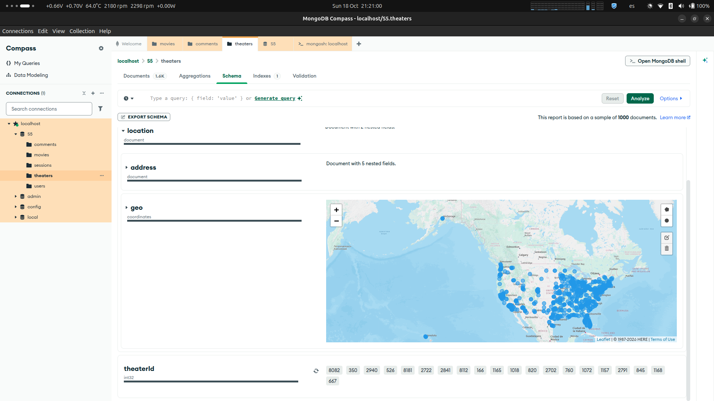